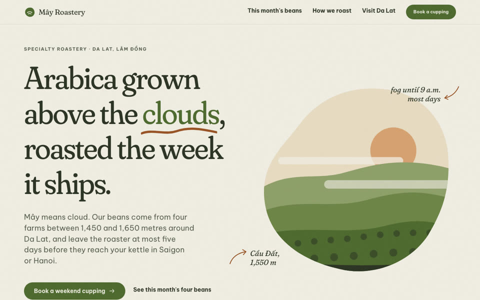
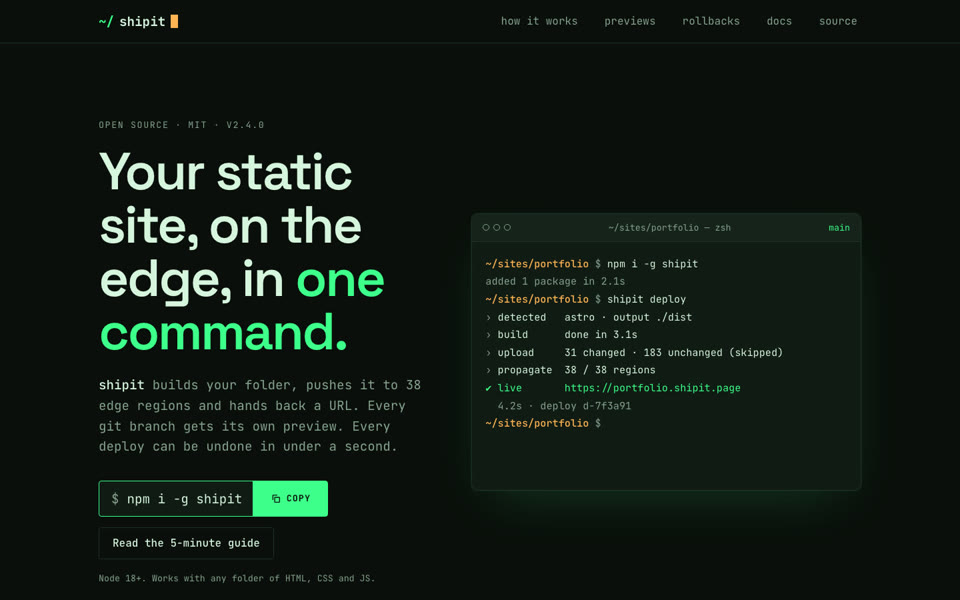
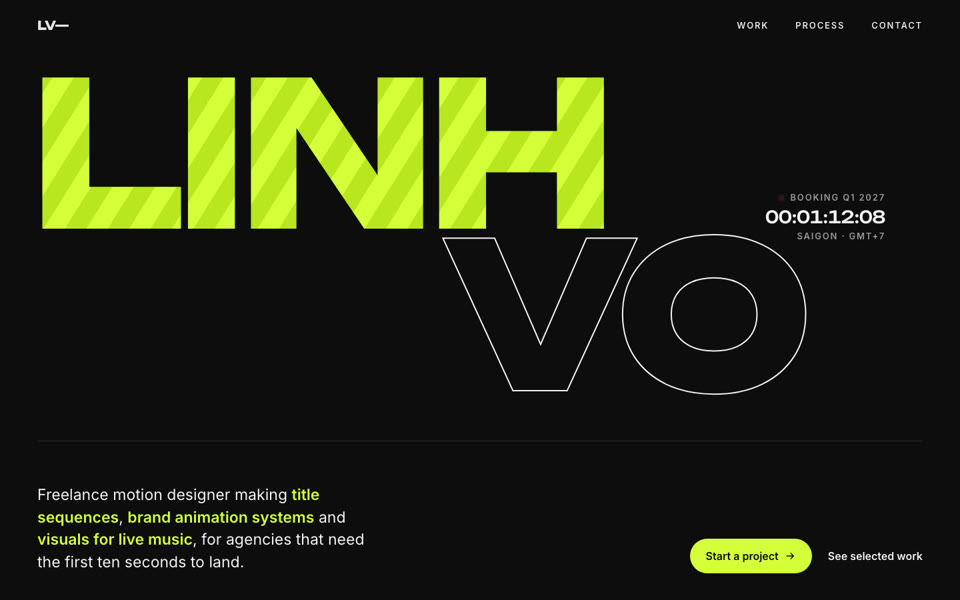

# junkio-skills

Claude Code skills by Junkio.

| Plugin | What it does |
|---|---|
| [`web-builder`](plugins/web-builder/skills/web-builder/SKILL.md) | Builds websites that look art-directed instead of AI-generated: picks a non-repeating visual direction, then builds, animates and self-reviews the page with screenshots. |

## Install

```
/plugin marketplace add tranjunp2-cloud/junkio-skills
/plugin install web-builder@junkio-skills
```

Then ask Claude for a site, or call the skill directly:

```
/web-builder landing page for a specialty coffee roastery in Da Lat
/web-builder portfolio for a motion designer --style kinetic
/web-builder SaaS homepage for an invoicing app --variants 3
```

## How web-builder works

1. **Read the brief** — subject, audience, tone, the one action a visitor should take; reuses the project's existing tokens and components.
2. **Pick an art direction** — 12 directions (bento, editorial, brutalist, glass, swiss, retro, luxury, playful, terminal, organic, kinetic, isometric). `scripts/pick-style.js` matches the brief and avoids directions used recently, so consecutive sites differ.
3. **Build** — tokens first, specific copy, a memorable layout signature, under 23 anti-slop rules.
4. **Animate** — one hero moment, one scroll behaviour, one hover language (GSAP or CSS), with `prefers-reduced-motion`.
5. **Self-review** — desktop + mobile screenshots against a checklist (distinctiveness, hierarchy, responsive, accessibility, performance), fix, repeat.

## Examples

Three runs of the skill, three directions — all fictional businesses, each a single self-contained HTML file in [`examples/`](examples/). Add `?static` to the URL to see the final state without animation.

| `organic` — coffee roastery | `terminal` — developer CLI | `kinetic` — motion designer |
|---|---|---|
|  |  |  |
| [page](examples/organic-coffee/index.html) | [page](examples/terminal-cli/index.html) | [page](examples/kinetic-portfolio/index.html) |

Works on its own. If `ui-ux-pro-max`, `gsap-*`, image-generation or browser-automation skills are installed, it uses them too.

## Tiếng Việt

`web-builder` giúp AI dựng website **đa dạng và đẹp hơn**: mỗi lần chọn một phong cách thiết kế khác (12 hướng), không lặp lại phong cách vừa dùng, viết nội dung cụ thể thay vì câu chữ chung chung, thêm hiệu ứng chuyển động, rồi tự chụp màn hình để rà soát và sửa trước khi bàn giao.

Cài đặt: chạy hai lệnh trong mục **Install** ở trên trong Claude Code.

## License

MIT
